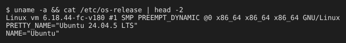

# TP exemple – Identification du système
> Nom Prénom | Classe | 28/10/2026
## 1. Objectif
Vérifier le système et la version du système.
## 2. Réalisation
### 2.1 Commandes utilisées
```
uname -a
cat /etc/os-release | head -2
```

## 3. Conclusion
Le système et sa version sont bien identifiés.
